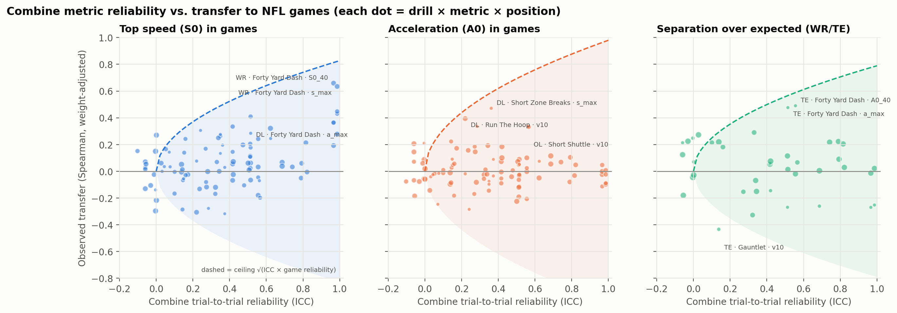
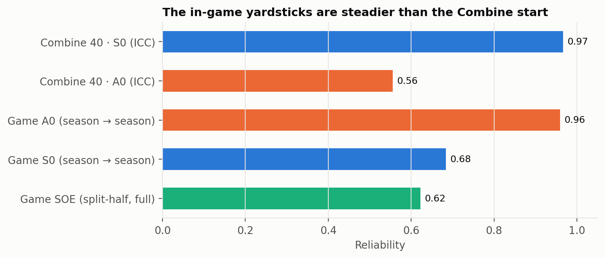
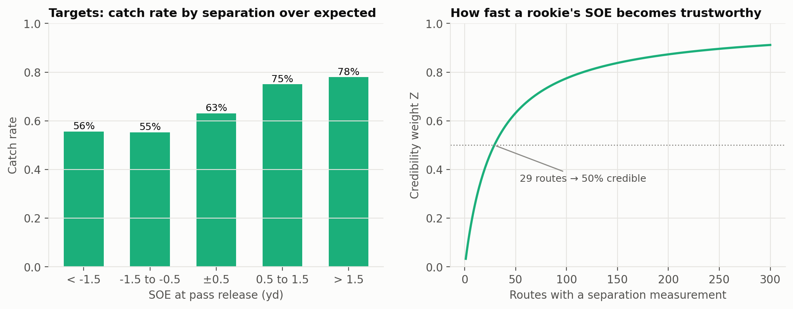

# NFL Big Data Bowl 2027：コンバインで測った動きのうち、何が試合に移るか

ドラフト前の測定会（コンバイン）のトラッキングデータと、同じ選手の NFL の試合のトラッキングデータを比べ、**どの測定値が試合に移り、どれが移らないか**を地図1枚にまとめた分析です（Kaggle の分析コンペ、Open Track に提出）。
わかったこと：**最高速は試合に移る（WR で相関 0.66）。スタートの加速は移らない。最初の 10yd は、センサーよりストップウォッチの公式タイムのほうが試合のスタートとつながる。**

- Writeup（提出済み・英語）：https://www.kaggle.com/competitions/nfl-big-data-bowl-2027/writeups/what-transfers-from-the-combine
- 本体ノートブック（移る／移らない地図・信頼性・SOE・DL の見かけの関係）：https://www.kaggle.com/code/takayuki0127/what-transfers-from-the-combine-bdb-2027
- 追加分析ノートブック（構えからのスタート・ストップウォッチ vs センサー・上乗せの効果・必要な試技数・頑健性）：https://www.kaggle.com/code/takayuki0127/bdb-2027-follow-up-analyses

コードと計算はすべて上の Kaggle ノートブックにあります（コンペのデータは再配布できないため、このリポジトリには README と図だけを置いています）。

---

## 1. 問い

コンバインでは 2023年から、すべてのドリルが 10Hz のセンサーで記録されています。チームはタイムだけでなく速度の曲線まで手に入ります。

- コンバインのトラッキング指標それぞれについて、同じ選手の試合の動きにどれだけ移るか
- 移らないとき、その理由は **測り方のばらつき（1〜2本では個人差が測れていない）** なのか、**能力そのものが試合に持ち越されない** のか

## 2. データ

- コンバインのトラッキング：56ドリル・6,142本（2023〜2025年）
- 同じ選手の NFL 試合のトラッキング（ルーキーのレギュラーシーズン）
- 対象：WR・TE・DB・OL・DL の5ポジション群

## 3. 手法

1. **試合側の物差しを作る**：速度と加速度の関係から、理論上の最大加速 A0 と最高速 S0 を選手ごとに推定（出場が多いほど最大値が大きく出る偏りを、同じフレーム数を抜き出して防いだ）。WR・TE は「期待よりどれだけ離れたか」（SOE、勾配ブースティングで期待値を予測）も作った
2. **コンバイン側を同じ物差しで測る**：1本目と2本目の一致度（ICC）で信頼性を出す
3. **当てられる上限と比べる**：上限 = √(コンバインの信頼性 × 試合側の信頼性)。上限に近ければ「移る」、信頼性が高いのに相関がなければ「移らない」、信頼性が低ければ「判断できない」
4. **見かけの関係を外す**：体重・配置（エッジかどうか）で統制。ブートストラップの 95% 信頼区間、758本の検定は Benjamini–Hochberg で多重比較を補正
5. **上乗せの効果**：公式タイム＋体重／トラッキング＋体重／両方、の3つでリッジ回帰を作り、5分割 CV を20回くり返して比べた

## 4. わかったこと

### 図1：移る／移らない地図

この図からわかること：点線（当てられる上限）の近くにあるのは、左のパネルの右上にある **40yd の最高速（WR・TE）だけ**。加速（中央）は信頼性が高くても 0 付近に集まり、試合に移っていない。

### 図2：物差しそのものの安定度

この図からわかること：試合側の A0（シーズン間 0.96）や、コンバインの最高速（0.97）は安定して測れている。コンバインの加速（0.56）は1本ごとのばらつきが大きい。

### 図3：SOE は成績とつながり、約30ルートで半分信用できる

この図からわかること：期待より離れているほど捕球率が上がる（56% → 78%）。ルーキーの SOE は **29ルート** で信用度 50% に届く。

### 数字のまとめ
| わかったこと | 数字 |
|---|---|
| 最高速は移る | WR 0.66（95%CI 0.44〜0.81）、TE 0.64（上限 0.81） |
| スタートの加速は移らない | ポジション別 −0.21〜0.26。構えからのスタートに絞っても 0.05（上限 0.71） |
| 最初の 10yd はストップウォッチが勝つ | 公式 10yd タイム → 試合のスタート速度 0.34（OL は 0.45）。センサーで測った 10yd は 0.19 |
| トラッキングを足しても予測は良くならない | 公式タイム＋体重に 40yd のトラッキングを足すと、CV の R² が 0.06 下がる |
| DL の「加速が大きいほどプレッシャーが多い」は見かけ | 統制前 0.57 → 体重と配置で統制後 0.07 |
| ドリルの切り返し指標は1〜2本では測れない | 信頼性 0.70 に必要な本数：加速 約8本、切り返しで保つ速度 約50本 |

### チームへの提言
1. コンバインでは最高速と公式 10yd タイムを信じる。トラッキングから出したスタートや切り返しの数字は割り引く
2. ルーキーは早めに試合の物差し（A0・SOE）に切り替える
3. 線の選手の運動能力を読むときは、体重と配置で統制してから見る

## 5. 限界
- 試合の物差しが作れたのは対象の 58〜69%（最高速は 505人中 292人）。出場した選手のほうが指名が早い。ただしコンバイン値のばらつきはほぼ同じ（標準偏差の比 0.84〜1.08）で、逆確率重み付けをしても結論は変わらない
- データにない特性（判断力など）で選ばれている可能性は確かめられない

## 使ったもの
Python（Kaggle Notebook で実行）

更新日：2026-10-20
